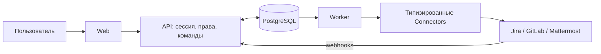

# Agentic Workspace Platform

Сверено с кодом 10 сентября 2026 года, базовая ревизия `abc5e86`.
[Все документы](docs/README.md) · [DevOps и внедрение](docs/deployment/README.md) ·
[Обновление стенда](docs/deployment/upgrade-and-verification.md).

Платформа для обработки запросов функциональных команд. Первый предметный модуль — QA:
приём запросов, ручные и автоматизированные проверки, очередь работ, результаты,
доказательства и итоговое решение QA. Один Workspace обслуживает несколько проектов
и задаёт границу доступа к их данным.

Jira хранит операционное состояние принятого запроса: статус, исполнителя, приоритет и сроки.
Платформа хранит QA-план, сессии, попытки, findings, evidence и решения людей. GitLab отвечает
за CI и артефакты, Mattermost — за приём обращений и уведомления. Hermes помогает готовить
предложения; правила доступа, переходы состояний и выполнение команд остаются детерминированными.

Проект — TypeScript monorepo на pnpm и Nx. API и worker используют NestJS, web — React/Vite,
данные — PostgreSQL и TypeORM. Расширения подключаются статически и поставляются общей сборкой.
Полный локальный контур работает с эмуляторами внешних систем. Корпоративное подключение
требует отдельной конфигурации и приёмки; его статус описан в [документации деплоя](docs/deployment/README.md).

## Содержание

- [Карта документации](docs/README.md)
- [Руководство пользователя и инструкции по ролям](docs/user-guide/README.md)
- [Первая корпоративная область QA](docs/deployment/initial-qa-workspace.md)
- [Локальный запуск](#локальный-запуск)
- [Настройки env](#настройки-env)
- [Как работает проект](#как-работает-проект)
- [Структура репозитория](#структура-репозитория)
- [Добавление Workspace и Project](#добавление-workspace-и-project)
- [Добавление пакета в monorepo](#добавление-пакета-в-monorepo)
- [Новый Competency Pack или Connector](#новый-competency-pack-или-connector)
- [Команды и проверки](#команды-и-проверки)
- [Диагностика](#диагностика)

## Первая корпоративная установка

Для приёма проектов подготовлен [отдельный запуск QA](docs/deployment/initial-qa-workspace.md):
один образ API/web, PostgreSQL, Keycloak и HTTPS. Bootstrap пустой базы создаёт одну
область **QA** без демоданных. Первый корпоративный пользователь получает права
администратора доступов и этой области; после MFA можно назначать коллег и создавать проекты.
Новые проекты имеют статус `DRAFT / MANUAL_ONLY`. Подключение провайдеров и полный
QA runtime остаются следующим этапом. Локальный seed для корпоративной установки не используется.

## Локальный запуск

Все команды ниже выполняются из корня репозитория.

### Требования

| Инструмент                     | Требуемая версия                                            |
| ------------------------------ | ----------------------------------------------------------- |
| Node.js                        | **24.20.0**, зафиксирована в [.node-version](.node-version) |
| pnpm                           | **11.21.0**, зафиксирована в [package.json](package.json)   |
| Docker Engine / Docker Desktop | Engine **24+**, запущенный daemon                           |
| Docker Compose                 | **2.20+**                                                   |

Для генерации локального TLS-сертификата также нужны Bash и OpenSSL. Первые установка
зависимостей и сборка образов требуют доступа к registries. Работа локального приложения
не требует VPN, корпоративных credentials или запущенных Jira/GitLab/Mattermost.

Если используете nvm и Corepack:

```bash
nvm install 24.20.0
nvm use 24.20.0
corepack enable
corepack prepare pnpm@11.21.0 --activate
pnpm install --frozen-lockfile
pnpm prerequisites
```

`preinstall` тоже проверяет инструменты. Несовпадение Node/pnpm не обходите обновлением lockfile:
сначала переключите версию. Если Corepack отсутствует, установите pnpm 11.21.0 своим менеджером
инструментов. Зависимости и версии для проекта уже зафиксированы.

### Полный QA pilot

```bash
pnpm dev:pilot:up
pnpm dev:pilot:status
```

Launcher создаёт сертификат Fake IdP, собирает общий образ приложения, поднимает PostgreSQL,
применяет migrations, загружает seed и запускает API, worker, web, Mock Hub и Collector.
Compose-проект называется `awp-local-pilot-dev`, порты доступны только через localhost.

| Сервис             | Адрес                                                               |
| ------------------ | ------------------------------------------------------------------- |
| Web                | [localhost:55173](http://localhost:55173)                           |
| API readiness      | [localhost:5300/health/ready](http://localhost:5300/health/ready)   |
| OpenAPI / Swagger  | [localhost:5300/api/docs](http://localhost:5300/api/docs)           |
| Worker readiness   | [localhost:5310/health/ready](http://localhost:5310/health/ready)   |
| Mock Hub readiness | [localhost:54010/health/ready](http://localhost:54010/health/ready) |
| Fake IdP           | [localhost:54443](https://localhost:54443) — локальный TLS          |
| Collector OTLP     | HTTP `localhost:54318`, gRPC `localhost:54317`                      |

На новой БД и после первого применения миграции Core 230 **первый успешный вход
однократно назначает глобального администратора**. Сначала войдите под выбранной
учётной записью и проверьте «Пользователи и доступы»; затем запускайте browser smoke
и передавайте стенд команде. Seed, повторный вход и рестарт не меняют сделанный выбор.
Порядок обновления — в [инструкции DevOps](docs/deployment/upgrade-and-verification.md).

Для QA выберите **«Заказчик»** и нажмите **«Начать работу»**. В меню откройте
**«Новый запрос»**, выберите доступный проект и заполните сведения. Нажмите
**«Проверить запрос»**, проверьте резюме и нажмите **«Отправить запрос»**.
После сообщения **«Запрос создан»** откройте созданный запрос.

**«Запросы»** и **«Очередь»** объединяют доступные проекты выбранной рабочей области.
Глобального переключателя рабочего проекта нет: проект задаётся в форме создания,
карточке и её ссылке. Заказчик видит проекты с явным назначением, QA 1 и QA 2
работают общей командой области. **«Сменить роль»** очищает контекст; переходы по меню
сохраняют вход, обновление страницы требует повторного входа.

В локальном контуре также доступны [технические писатели](docs/user-guide/tech-writing.md),
[создание и редактирование проектов](docs/user-guide/administration.md#создать-проект),
[диалог заказчика с Hermes](docs/user-guide/customer-projects.md) и управление ролями
через `/admin/users`.

Справка доступна в **«Как работать»**, технические панели — в **«Дополнительно → Инструменты
разработки»**. Для защищённых административных действий доступно дополнительное подтверждение входа.
У свежих проектов стартовое состояние `DRAFT / MANUAL_ONLY`; это не означает готовность ко всем операциям.
Подробнее — [руководство по интерфейсу](docs/runbooks/interface-guide.md).

```bash
pnpm dev:pilot -- up --plan  # показать настройки, не запуская контейнеры
pnpm dev:pilot -- logs      # последние 200 строк логов сервисов
pnpm dev:pilot -- migrate   # повторно применить доступные migrations
pnpm dev:pilot -- seed      # повторно вызвать versioned seed
pnpm dev:pilot:down         # остановить контур, сохранив volumes
```

Повторный запуск сохраняет данные, версии onboarding и приостановленные проекты.
В launcher pilot нет команды reset. Сервисы запускаются из образа без bind mount исходников:
после изменения серверного кода повторите `pnpm dev:pilot:up`, чтобы пересобрать образ.
Подробнее — [локальный pilot](docs/runbooks/pilot-development.md).

### Минимальный контур и отдельные профили

`foundation` полезен для работы над Platform Core и Dummy Pack:

```bash
pnpm local:up
pnpm local:status
pnpm local:logs -- api worker
pnpm local:down
```

Он использует Compose-проект `awp-local`: web `5173`, API `3000`, worker `3010`,
Mock Hub `4010`, Fake IdP `4443`. QA Pack в `foundation` не включён.
`local:*` сбрасывает выбранную в shell composition в `foundation`.

Для отдельных сценариев существуют launchers в [tools/local](tools/local):
`cli.mts qa up` — ручной QA, `jira-cli.mts up` — QA/Jira,
`mattermost-cli.mts up` — QA/Jira/Mattermost, `gitlab-cli.mts up` — QA/Jira/GitLab,
`queue-cli.mts up` и `onboarding-cli.mts up` — полный локальный состав с нужными флагами.
Запускайте их через `node tools/local/<имя>.mts <операция>`.
Эти узкие профили используют общие стандартные порты; остановите предыдущий перед переключением.

## Настройки env

### Реальный деплой

Для [первой области QA](docs/deployment/initial-qa-workspace.md) используйте
`infra/deploy/compose.workspace.yml` и `workspace.config.example.json`.
Таблица ниже относится к **полному корпоративному пилоту**; для него используйте
[шаблон env для деплоя](docs/deployment/templates/runtime.env.example) и
[DeploymentPolicy](docs/deployment/templates/deployment-policy.template.json).
Корневой [.env.example](.env.example) предназначен **только для локальной разработки**.

Текущий целевой контур — **NON_PROD с реальными Jira/GitLab/Mattermost**.
Это отличается от локального pilot с Mock Hub. Полная корпоративная сборка API/worker
ещё требует завершения [008/T025](docs/deployment/README.md): env ниже описывают конфигурацию
стенда, но сами по себе не создают готовое приложение для деплоя.

**Обязательные настройки API и worker** — передаются обоим процессам, кроме явно указанного API origin:

| Переменная                  | Что задать на стенде                                                                                                                                     |
| --------------------------- | -------------------------------------------------------------------------------------------------------------------------------------------------------- |
| `AWP_ENVIRONMENT`           | `NON_PROD`.                                                                                                                                              |
| `AWP_COMPOSITION`           | `qa-jira-gitlab-mattermost-development` или `qa-jira-gitlab-mattermost-test`. Одинаковое значение у API и worker; здесь `development` не означает mocks. |
| `AWP_EXTERNAL_NETWORK_MODE` | `allowlisted`; разрешённые endpoints и транспорт задаются опубликованной policy и host bindings.                                                         |
| `AWP_DEPLOYMENT_CONFIG`     | **Содержимое JSON** опубликованной DeploymentPolicy, не путь к файлу; до 65 536 символов. Одинаковая policy у API и worker.                              |
| `AWP_DATABASE_URL`          | DSN реальной PostgreSQL с runtime credentials и настроенным TLS. Миграции выполняются отдельной ролью.                                                   |
| `AWP_IDENTITY_ISSUER`       | HTTPS issuer корпоративного OIDC; должен совпадать с `identity.url` в policy.                                                                            |
| `AWP_IDENTITY_AUDIENCE`     | Audience, согласованная с корпоративным IdP.                                                                                                             |
| `AWP_WEB_ORIGIN`            | **Только API:** публичный HTTPS origin web для CORS. Локальный default не подходит.                                                                      |

**Необязательные настройки и значения по умолчанию:**

| Переменная               | Назначение                                                                                                                                                                         |
| ------------------------ | ---------------------------------------------------------------------------------------------------------------------------------------------------------------------------------- |
| `AWP_DEPLOYMENT_PROFILE` | В шаблоне явно задан `integration`; после допуска — согласованный `pilot`. При наличии должен совпадать с `deploymentProfile` в JSON policy; без env используется значение policy. |
| `AWP_RUNTIME_PROFILE`    | Legacy-совместимость: `non-local`. При заданном `AWP_ENVIRONMENT=NON_PROD` parser выводит профиль сам; если передать оба, значения должны согласовываться.                         |
| `PORT`                   | Внутренний HTTP-порт API, default `3000`. Публикацию порта настраивает инфраструктура.                                                                                             |
| `WORKER_HEALTH_PORT`     | Внутренний health-порт worker, default `3010`.                                                                                                                                     |
| `AWP_MODEL_PROVIDER`     | Ключ провайдера модели, если он используется. Policy, credentials и реализация adapter передаются отдельно.                                                                        |

**Web и Collector конфигурируются отдельно от API/worker:**

| Куда передать | Переменная                     | Значение                                                                                                 |
| ------------- | ------------------------------ | -------------------------------------------------------------------------------------------------------- |
| Сборка web    | `VITE_AWP_COMPOSITION`         | Та же корпоративная composition, что у backend.                                                          |
| Сборка web    | `VITE_AWP_AUTH_MODE`           | `corporate`: вход, доступы, каталог, создание и редактирование проектов; полный QA routing требует T025. |
| Сборка web    | `VITE_AWP_API_URL`             | Публичный HTTPS origin API.                                                                              |
| Collector     | `AWP_TELEMETRY_BACKEND_ORIGIN` | HTTPS endpoint корпоративного OTLP HTTP backend. CA и клиентские сертификаты подключаются отдельно.      |

`VITE_*` попадают в browser bundle и задаются **при сборке**. Изменение env уже запущенного
web не обновляет bundle. Web и корпоративный BFF должны использовать общий HTTPS origin.
Первый проверенный корпоративный вход выбирает администратора независимо от локального;
[настройка Keycloak и первого входа](docs/deployment/corporate-access.md).
Переменная Collector не заменяет telemetry bindings приложения.

Node читает `process.env` и не загружает `.env` автоматически. Передайте настройки через
конфигурацию workload, а credentials — через secret store. Общего механизма `*_FILE` нет.
Помимо env, корпоративные entry points должны передать published connector bindings,
identity/session services, secret resolver, signer и другие host adapters. Например,
`AWP_GITLAB_BASE_URL` и `AWP_GITLAB_*_SECRET_REF` из legacy-конфигурации не заменяют такую сборку.
Точный контракт — в [настройках корпоративной среды](docs/deployment/configuration.md).

### Локальная разработка и проверки

Для `pnpm dev:pilot:up` заполнять env не нужно: launcher и Compose задают локальные адреса,
порты, эмуляторы и тестовые ключи. В конфигурацию реального стенда этот набор не копируется.

| Только для локального сценария                                                                    | Для чего используется                              |
| ------------------------------------------------------------------------------------------------- | -------------------------------------------------- |
| `AWP_MOCK_HUB_URL`, `MOCK_HUB_*`, `FAKE_IDP_*`                                                    | Эмуляторы провайдеров и локальный IdP.             |
| `AWP_LOCAL_PROJECT_NAME`, `AWP_*_HOST_PORT`, `AWP_PUBLIC_API_URL`, `COMPOSE_PROFILES`             | Управление локальным Compose и публикацией портов. |
| `AWP_QUEUE_STATIC_CONTOUR`, `AWP_ONBOARDING_STATIC_CONTOUR`, `AWP_PILOT_ADAPTER_MODE=development` | Подключение локальных модулей и dev-адаптеров.     |
| `AWP_EVIDENCE_SIGNER=local-ed25519` и локальные signing keys                                      | Подпись evidence в локальном контуре.              |
| `AWP_RUN_CONTAINER_TESTS=true`                                                                    | Запуск тестов с Testcontainers.                    |

Полный список с defaults, назначением каждого ключа [.env.example](.env.example),
приоритетами launcher/Compose, локальным TLS и вспомогательными настройками перенесён в
[справочник локальных env](docs/runbooks/local-environment.md).

## Как работает проект



В локальном режиме роль всех внешних систем выполняет stateful Mock Hub. Диаграмма показывает
путь внешних бизнес-команд; чтение контекста и проверки capabilities также выполняются из API.

1. Пользователь работает в контексте Workspace и Project. Сервер вычисляет доступ как пересечение
   membership, Project Entitlement, разрешения роли и классификации данных; default — deny.
2. Ввод попадает в Candidate/Draft. Он становится принятым Work Item после явного подтверждения
   и с действующим integration binding. При недоступной Jira фиктивный принятый запрос не создаётся.
3. API проверяет права, версии и правила, сохраняет изменения и durable-команду в PostgreSQL.
   Worker получает команду, вызывает Connector, проверяет фактический результат и обновляет
   состояние. Inbox/outbox, idempotency и audit обеспечивают восстановление после сбоев.
4. QA Pack создаёт отдельные MANUAL или AUTOMATED sessions. GitLab выполняет автоматические
   проверки; попытки и findings сохраняются. Retry не стирает предыдущие результаты.
5. Человек проверяет evidence и подписывает итоговый QA verdict. Завершённая QA-работа может
   иметь `FAIL`: это результат проверки, а не разрешение выпуска продукта.

Platform Core владеет общими механизмами: доступом, Work Item, approvals, audit и доставкой событий.
Competency Pack владеет предметными правилами и UI; Connector реализует типизированную capability
для конкретного провайдера. Connection/Profile/Mapping/Binding связывают проект с интеграцией;
опубликованные версии сохраняются в истории.

В v1 нет Redis/BullMQ и S3: очередь и leases находятся в PostgreSQL, бинарные CI artifacts
остаются в GitLab, ручное QA сохраняет metadata без загрузки вложений.
Hermes поставляется отдельным сервисом для первого запуска: диалог проектов, LLM с локальным резервом,
Mattermost ask/test и точное подтверждение Jira-команды в чате. В первой версии используется явный
контекст проекта без RAG. [Настройка Hermes](docs/deployment/hermes-service.md).
Полная durable-сборка автономных QA Agent Runs остаётся отдельным ограничением.
Подробнее — [архитектура и диаграммы](docs/architecture/README.md),
[конституция](.specify/memory/constitution.md), [ADR](docs/adr).

## Структура репозитория

| Каталог                                              | Содержание                                                                                   |
| ---------------------------------------------------- | -------------------------------------------------------------------------------------------- |
| `apps/api`, `apps/worker`, `apps/web`, `apps/hermes` | Основные процессы приложения.                                                                |
| `apps/fake-idp`, `apps/mock-hub`                     | Локальная идентификация и эмуляторы провайдеров.                                             |
| `packages/platform-*`                                | Общие contracts, Core, persistence, Nest adapters, UI и testkit.                             |
| `packages/competency-*`                              | SDK и предметные модули Dummy/QA.                                                            |
| `packages/connector-*`                               | SDK, Mock/Jira/GitLab/Mattermost и отдельные persistence adapters.                           |
| `packages/runtime-composition`                       | Статическая сборка расширений, конфигурация, migrations, seed, security и worker wiring.     |
| `infra`, `config`                                    | Docker Compose, сертификаты, Collector и конфигурации окружений.                             |
| `tests`                                              | Unit, architecture, contract, integration, security и browser-проверки.                      |
| `tools`                                              | Локальный запуск, генерация contracts, архитектурные проверки, CI и gates.                   |
| `docs`                                               | Архитектура, ADR, runbooks и инструкции деплоя.                                              |
| `specs`, `.specify`                                  | Feature specs, планы, tasks, контракты и настройки Spec Kit.                                 |
| `reports`, `artifacts`                               | Генерируемые результаты проверок; наличие старого отчёта не подтверждает текущую готовность. |

## Локальная рабочая область технических писателей

После `pnpm dev:pilot:up` на [localhost:55173](http://localhost:55173) доступны дополнительные
роли **Технический писатель** (`writer.docs`) и **Лид технических писателей** (`lead.docs`).
Выберите роль и нажмите «Начать работу»; пароль не нужен. Область **Техническая документация**,
проект **ALPHA-DOCS** добавляются отдельным versioned seed без сброса БД и изменения QA-данных.

Писатель видит свои задания, черновики и замечания; лид — очередь ревью и библиотеку документов.
Для сравнения используйте «Сменить роль». Цикл: сохранение черновика → ревью →
возврат с замечанием → доработка → повторное ревью → утверждение точной редакции.
Изменение утверждённого текста снимает действующее утверждение. Доступ проверяется на сервере.

Начальные примеры и новые задания позволяют повторить процесс. Подробности:
[руководство](docs/user-guide/tech-writing.md), [Spec Kit 015](specs/015-tech-writing-workspace/spec.md),
[отчёт проверки](specs/015-tech-writing-workspace/validation.md). Это расширение локального
тестового сценария по [ADR-0010](docs/adr/0010-local-tech-writing-workspace.md); production scope первого релиза остаётся прежним.

## Добавление Workspace и Project

### Workspace платформы

Workspace — граница безопасности, а Project — обслуживаемый проект внутри неё.
Публичного UI/API создания Workspace сейчас нет. Для нового **локального демонстрационного**
Workspace добавьте versioned seed по образцу
[local-seed.ts](packages/runtime-composition/src/seed/local-seed.ts):

1. Задайте уникальные ID/key и запись Workspace. Сейчас seed создаёт `local-functional`
   с ALPHA/BETA/GAMMA и `local-isolated` с DELTA. Отдельный
   [seed технической документации](packages/runtime-composition/src/seed/tech-writing-local-seed.ts)
   создаёт `local-tech-writing` с ALPHA-DOCS.
2. Добавьте identities, активные `workspace_memberships`, назначения ролей и разрешённые
   `workspace_work_types`. Одной строки в `workspaces` недостаточно.
3. Свяжите демонстрационные персоны с Workspace/Project в
   [local-security.ts](packages/runtime-composition/src/security/local-security.ts).
   Project Entitlements задаются отдельно от membership.
4. Зарегистрируйте проекты и их конфигурацию; проверьте вход нужной персоны и отказ в доступе
   к соседнему Workspace/Project.
5. Примените новую версию seed. `LOCAL_SEED_KEY` / `LOCAL_SEED_VERSION` отмечают уже выполненные
   версии: простая правка старого seed и повторный `seed` не добавят данные. Существующие
   данные обновляйте отдельным идемпотентным шагом, сохраняя текущие memberships и revisions.

Первую корпоративную область QA создаёт [bootstrap установки](docs/deployment/initial-qa-workspace.md).
Создание дополнительных корпоративных областей требует отдельной административной реализации;
локальные персоны предназначены для разработки.

### Project в существующем Workspace

Администратор области или регистратор проектов создаёт проект через
**«Проекты → Новый проект»** (`/projects/new`). Форма показывает доступные рабочие
области и их участников, требует причину и свежее подтверждение входа.
Карточка редактируется на `/projects/:projectId/edit` с правом `project.metadata.update`;
изменения сохраняют версию и историю. См. [инструкцию администратора](docs/user-guide/administration.md).

Заказчик использует **«Создать проект с Hermes»** (`/projects/hermes`): описывает
название и цель, проверяет карточку и явно подтверждает её. Это отдельное право
`project.request.create`; результат даёт заказчику доступ к конкретному проекту,
а общей команде — её обычные рабочие права. [Сценарий и ограничения](docs/user-guide/customer-projects.md).

Для интеграционных клиентов остаётся `POST /api/v1/workspaces/:workspaceId/projects`:
проверенная human session, актуальное право `project.register`, step-up не старше
пяти минут и `Idempotency-Key`. Тело содержит `key`, `name`, `ownerIds`,
`criticalityKey`, `dataClassificationKey` и `reason`; ответственные должны быть
действующими участниками выбранной области.

Новый проект получает `DRAFT / MANUAL_ONLY`. Создание не подключает внешние системы.
Дальнейший порядок: права → environments и QA resources/context →
Connection/Profile/Mapping/Binding → validation и probes → QA acceptance →
подтверждённая публикация Binding → onboarding evaluation. Для FULL_QA дополнительно
нужны принятый Suite и требуемые capabilities.

Каталог находится на `/projects`, состояние подключения — на `/projects/:id/onboarding`.
Точные запросы, ETag и версии — в [onboarding API 1.1](docs/runbooks/onboarding-openapi-convergence.md)
и [ручном onboarding](docs/runbooks/manual-onboarding-journey.md).

## Добавление пакета в monorepo

pnpm workspace — приложение или библиотека кода. Создание такого пакета не создаёт Workspace
платформы и не выдаёт пользователям доступ.

1. Создайте `packages/<name>` для библиотеки или `apps/<name>` для приложения. Эти glob уже
   перечислены в [pnpm-workspace.yaml](pnpm-workspace.yaml).
2. Добавьте `package.json` с уникальным именем `@awp/<name>`, `private: true`, `type: module`
   и явными `exports`. Для внутренних зависимостей используйте `workspace:*`, для общих
   версий из catalog — `catalog:`.
3. Добавьте `src/index.ts` и `tsconfig.json`, расширяющий `../../tsconfig.base.json`.
   Образец минимальной библиотеки — [competency-dummy](packages/competency-dummy).
4. Добавьте `project.json` с уникальным Nx name, `root`, `sourceRoot`, `projectType`,
   корректными tags и targets `typecheck`/`build`. Посмотрите
   [пример Nx-проекта](packages/competency-dummy/project.json): у серверных библиотек build
   может проверять типы без генерации JS, web собирает bundle.
5. Добавьте alias в [tsconfig.base.json](tsconfig.base.json) и зависимость в manifest потребителя.
6. Зарегистрируйте пакет в `projectRules` и `packageToProject` файла
   [dependency-rules.mts](tools/architecture/dependency-rules.mts). Одних Nx tags недостаточно.
   Для нового app обновите также список приложений в
   [check-import-graph.mts](tools/architecture/check-import-graph.mts).
7. Выполните `pnpm install` и проверьте изменения lockfile, затем:

   ```bash
   pnpm exec nx show project <name>
   pnpm exec nx run <name>:typecheck
   pnpm architecture
   pnpm lint
   ```

## Новый Competency Pack или Connector

Новый предметный модуль создаётся как `packages/competency-<domain>`.
[Dummy](packages/competency-dummy) показывает минимальный manifest,
[QA](packages/competency-qa) — domain/application, server и UI entrypoints.

- Опишите Work Types, versioned schemas, capabilities, events, actions и UI slots через SDK.
  Зарегистрируйте схемы в
  [schema-contributions.ts](packages/platform-contracts/src/schema-contributions.ts).
- Подключите manifest и реализации в
  [runtime-composition](packages/runtime-composition/src/extensions/composition.ts),
  ориентируясь на [QA contributions](packages/runtime-composition/src/qa/contributions.ts).
  Один manifest не регистрирует HTTP handlers, worker и UI автоматически.
- При наличии persistence явно подключите entities и migrations в
  [entity-composition.ts](packages/runtime-composition/src/persistence/entity-composition.ts) и
  [migrations/composition.ts](packages/runtime-composition/src/migrations/composition.ts)
  либо в специализированной composition. Сохраняйте порядок migrations и исторические revisions.
- Подключите API handlers, worker contributions и UI в соответствующих `apps`.
  Для нового composition key обновите parser environment, выбор composition и локальный launcher.
- Внешний протокол оформите отдельным `packages/connector-<provider>` с typed capability,
  stateful mock и contract tests. Pack объявляет capability; runtime-composition связывает её
  с Connector. Core и предметные правила не вызывают provider API напрямую.
- Пересоберите contracts: `pnpm contracts:build`, при изменении OpenAPI —
  `pnpm contracts:openapi`; выполните архитектурные, contract и профильные проверки.

Расширения устанавливаются общей сборкой. Динамической установки Pack из UI, marketplace
или отдельных runtime-версий на Workspace нет.

## Команды и проверки

| Команда                                           | Назначение                                                                                              |
| ------------------------------------------------- | ------------------------------------------------------------------------------------------------------- |
| `pnpm format` / `pnpm format:check`               | Форматирование Prettier / проверка без изменений.                                                       |
| `pnpm lint` / `pnpm lint:fix`                     | ESLint без допустимых предупреждений / автоматические исправления.                                      |
| `pnpm typecheck`                                  | Типы корня и всех Nx-проектов.                                                                          |
| `pnpm build`                                      | Build targets всех проектов, включая web bundle.                                                        |
| `pnpm architecture`                               | Границы зависимостей между слоями.                                                                      |
| `pnpm contracts:build` / `pnpm contracts:openapi` | Реестр schemas / OpenAPI snapshots.                                                                     |
| `pnpm test`                                       | Vitest; container suites требуют `AWP_RUN_CONTAINER_TESTS=true` и Docker.                               |
| `pnpm ci:project`                                 | Общая регрессия: формат, lint, типы, build, architecture, contracts, dependency audit и тесты с Docker. |
| `pnpm ci:008`                                     | Расширенные локальные pilot gates, включая browser/recovery-проверки.                                   |

Перед отправкой изменений выполните `pnpm format:check`, `pnpm lint`, `pnpm typecheck` и
проверки затронутой функциональности. Для полного локального CI нужны Docker и браузер
Playwright; установите его через `pnpm exec playwright install chromium`.
В [инструкции GitLab CI](docs/runbooks/gitlab-pipeline.md) описаны инфраструктура и gates.

Для Jira доступны `pnpm ci:003` и `pnpm verify:003:evidence`: первый выполняет локальный gate,
второй проверяет актуальность evidence относительно исходников. Live NON_PROD-проверка
опциональна и без требуемых входных данных/opt-in остаётся `SKIPPED_GATED`.
Запись в production Jira запрещена; production actions и решения о выпуске не входят в первый релиз.

Отдельный тест можно запустить без нового alias:

```bash
pnpm exec vitest run tests/architecture/010-v1-infrastructure-boundaries.spec.ts
pnpm exec nx run competency-qa:typecheck
```

Корневые scripts сохраняют повседневные команды, локальные launchers и aliases, которые
требуются действующим CI-контрактам. Избыточные команды отдельных этапов убраны;
[справочник команд и точные замены старых aliases](docs/runbooks/developer-commands.md)
поможет запускать проверки из исторических specs.

Новые features оформляются через Spec Kit: `speckit-specify` → `speckit-plan` →
`speckit-tasks` → `speckit-implement`. Спецификации и завершение задач находятся в `specs/`.

## Диагностика

- **Неверная версия Node/pnpm:** проверьте `node --version`, `pnpm --version`, затем
  `pnpm prerequisites`. Открытый терминал может использовать системный Node вместо выбранного nvm.
- **Docker недоступен:** запустите Docker Desktop/daemon и проверьте `docker info`.
- **Порт занят:** проверьте `docker ps` и `lsof -nP -iTCP:55173 -sTCP:LISTEN`.
  Pilot фиксирует свои порты; узкие профили используют общие стандартные порты.
- **Контейнер не готов:** выполните `pnpm dev:pilot:status` и `pnpm dev:pilot -- logs`.
  `core-migrate`, `mock-migrate`, `core-seed`, `mock-seed` — одноразовые jobs; `Exited (0)` для них штатно.
- **Нет доступа в web:** сначала выберите персону и выполните вход; проверьте Workspace/Project
  и права этой персоны. Для административного действия может требоваться step-up.
- **Изменения seed не видны:** проверьте версию seed; повтор уже применённой версии пропускается.
- **Нужна реальная интеграция:** начните с [комплекта деплоя](docs/deployment/README.md) и
  [формы входных данных](docs/runbooks/pilot-integration-intake.md). Успех локальных mocks
  не заменяет приёмку установленного провайдера.
