# Архитектура Agentic Workspace Platform

Срез **10.09.2026**, репозиторий `PlatformWorkspace`, базовая ревизия `3a7b21c`, с изменениями первоначальной установки QA. Схемы восстановлены по исходникам, точкам сборки, миграциям, Compose и ADR. Это описание кода; наличие узла не подтверждает его развёртывание на корпоративном стенде.

**Архитектурный стиль:** модульное приложение с отдельными процессами API и worker, общим PostgreSQL, статически подключаемыми Competency Packs и типизированными интеграциями. QA — первый бизнес-модуль. Jira хранит операционное состояние запроса, платформа — QA-исполнение, доказательства и решения людей.

**Граница готовности:** полный локальный контур собирается. Корпоративные адаптеры и проверки реализованы частями; полная прикладная сборка API/worker остаётся открытой задачей `008/T025`. В Feature 008 закрыты **108 из 115 задач**; открыты T025, T040, T057, T084, T104, T105, T106. Полный актуальный подсчёт по доступным `tasks.md` приведён в [каталоге](inventory.md); исторические gate reports не подтверждают новую ревизию.

Навигация: [общая схема](#context) · [процессы](#runtime) · [модули](#modules) · [расширения](#extensions) · [данные](#data) · [команды](#commands) · [QA и очередь](#qa) · [GitLab](#automation) · [evidence](#evidence) · [безопасность](#security) · [развёртывание](#deployment) · [эксплуатация](#operations) · [технический каталог](inventory.md).

Легенда: сплошная стрелка — взаимодействие или связь в показанном контуре; пунктир — необязательная зависимость, доступный адаптер либо незавершённое подключение, указанное в подписи. Диаграммы данных показывают смысловые связи, а не полный физический DDL.

<a id="context"></a>

Для первоначальной корпоративной установки добавлен отдельный host
`apps/api/src/workspace-main.ts`: один API/web образ, корпоративные сессии,
администрирование доступов и приём карточек проектов. `prepareQaWorkspace` создаёт
одну QA-область в пустой БД; миграция 235 хранит неизменяемые квитанции установки
и первого workspace-администратора. Первый проверенный корпоративный вход назначает
глобальную и workspace-роли атомарно. Существующие установки без квитанции не меняют
поведение первого входа. Provider adapters, worker и исполнение QA в этот host не входят.
[Развёртывание и граница готовности](../deployment/initial-qa-workspace.md).

## 1. Общий контур

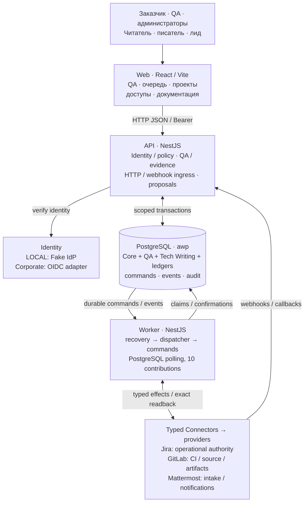

В **LOCAL** все три provider adapter работают против **stateful Mock Hub**; отдельные Jira/GitLab/Mattermost серверы в Compose не запускаются. Блоки провайдеров обозначают их роли и протоколы. HTTP-чтения для validation, capability probes и context могут выполняться также из API/application services; durable worker-путь показан для внешних бизнес-эффектов.

Hermes не является отдельным развёрнутым сервисом. В коде есть agent runtime, typed tool gateway, persistence и детерминированные исполнители. В основном наборе десяти worker contributions отдельного Hermes executor нет; `createHermesComposition()` использует `InMemoryDurableAgentRunPort`. Наличие `agent_runs` в PostgreSQL не доказывает полный цикл исполнения этих записей.

Источники: [API bootstrap](../../apps/api/src/main.ts), [worker bootstrap](../../apps/worker/src/main.ts), [worker phases](../../apps/worker/src/app.module.ts#L60), [Hermes composition](../../packages/runtime-composition/src/hermes/composition.ts), [AgentRun HTTP](../../apps/api/src/extensions/core-intake-http-api.ts#L64).

<a id="runtime"></a>

## 2. Процессы, стек и профили

| Компонент       | Ответственность                                                                                                      | Фактическая поставка                                                               |
| --------------- | -------------------------------------------------------------------------------------------------------------------- | ---------------------------------------------------------------------------------- |
| `apps/web`      | Формы intake, Work Item detail, manual/automated QA, queue/portfolio, project onboarding/evidence, pilot diagnostics | React 19.2.8, Vite 8.2.2, UI через MUI 9.3.1; выбор представления в `App.tsx`      |
| `apps/api`      | NestJS HTTP, authentication/authorization, scoped queries, mutations, прием webhook, постановка команд               | NestJS 11.2.3, Express adapter; health на 3000                                     |
| `apps/worker`   | Durable delivery, reconciliation, projections, probes, retention                                                     | NestJS, цикл раз в 1 секунду; health на 3010; нет отдельного публичного бизнес-API |
| `apps/mock-hub` | Stateful HTTP-эмуляторы внешних систем, faults и счётчики effects                                                    | Собственная БД `awp_mock`, отдельная роль; local-only                              |
| `apps/fake-idp` | OIDC/JWKS, local personas и local step-up                                                                            | HTTPS на 4443; local-only                                                          |
| PostgreSQL      | Транзакционные доменные данные, claims/leases, revisions, inbox/outbox, audit                                        | Compose фиксирует 18.6; миграции имеют проверки для 17/18                          |
| Collector       | Приём OTLP traces/metrics, редактирование атрибутов                                                                  | 0.135.0; optional Compose profile `observability`, включается pilot launcher       |

Версии указаны **из manifest/catalog/Compose репозитория**, а не как рекомендация обновления. Требуемые инструменты проекта: Node 24.20.0, pnpm 11.21.0, TypeScript 6.0.3, Nx 23.1.2, TypeORM 1.1.0.

| Composition                                         | Состав и граница                                                                            |
| --------------------------------------------------- | ------------------------------------------------------------------------------------------- |
| `foundation`                                        | Extension kernel + Dummy/Mock; QA не активируется как Pack                                  |
| `qa-local`                                          | Ручной QA + local operational mock; часть effects исполняется `INLINE_LOCAL` в API          |
| `qa-jira-local`                                     | QA + Jira HTTP adapter; operational effects передаются worker                               |
| `qa-jira-mattermost-local`                          | Предыдущий профиль + intake/callbacks/notifications и соответствующие project HTTP surfaces |
| `qa-jira-gitlab-local`                              | QA/Jira + GitLab automation                                                                 |
| `qa-jira-gitlab-mattermost-local`                   | Полный локальный контур; queue/onboarding активируются явными static contour flags          |
| `qa-jira-gitlab-mattermost-development` / `…-test`  | Полный corporate NON_PROD composition contract; требует явной host-сборки, сейчас неполной  |
| Другие ключи `…-nonprod`, `…-development`, `…-test` | Валидируются конфигурацией/registry; это не доказательство готового executable host         |

`AWP_ENVIRONMENT`, legacy `AWP_RUNTIME_PROFILE`, `AWP_COMPOSITION` и network mode должны согласовываться. `NON_PROD` — класс окружения интеграций; слово `development` в corporate composition не означает использование mocks. Модель данных допускает больше классов окружений, чем разрешено текущим effect boundary; production actions запрещены.

Источники: [catalog](../../pnpm-workspace.yaml), [environment](../../packages/runtime-composition/src/config/environment.ts), [selection](../../packages/runtime-composition/src/qa/composition.ts), [pilot composition](../../packages/runtime-composition/src/pilot/composition.ts), [Web dispatch](../../apps/web/src/App.tsx).

<a id="modules"></a>

## 3. Модули и границы зависимостей

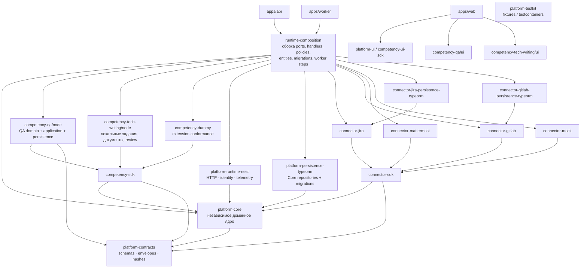

Стрелки здесь — основные зависимости исходного кода, а не сетевые вызовы. Полный граф импортов всех **24 workspace packages** (5 apps + 19 packages) приведён в [каталоге](inventory.md). `platform-testkit` содержит только fixtures/testcontainers и не входит в runtime graph.

| Область ядра               | Владеет                                                                                                    |
| -------------------------- | ---------------------------------------------------------------------------------------------------------- |
| Identity & access          | Identity, Workspace membership, role assignments, Project Entitlement, classification, authorization basis |
| Extension registry         | Статическая регистрация Pack, Work Type и Capability Contract, версии и совместимость                      |
| Integration registry       | Connection, Mapping, Profile, Project Integration Binding, validation и health                             |
| Work management            | Intake Draft/Candidate, generic Work Item, operational binding/projection, queue ordering/capacity/SLA     |
| Commanding & approval      | Typed command, exact approval, идемпотентность, повторная проверка прав перед effect, reconciliation       |
| Events & interactions      | Webhook receipts, event outbox, consumer inbox, dedupe, interaction/notification intents                   |
| Agent runtime              | Agent definition, versioned skill registry, scoped runs/grants, model proposal port, tool gateway          |
| Artifacts & audit          | Artifact references/authorization, append-only audit/provenance, safe redaction                            |
| Project onboarding & pilot | Registration, readiness/capability modes, suspension/recovery, deployment gates и evidence records         |

Текущая local сборка также подключает Tech Writing: задания, версии документов, замечания и утверждение точной редакции в отдельном Workspace. Роли QA действуют на общую команду области; права заказчиков привязаны к конкретным проектам. UI создания и редактирования проектов использует текущие серверные разрешения. Диалоги заказчика с Hermes сохраняются в PostgreSQL и создают проект после явного подтверждения; этот сценарий не требует отдельного LLM/AgentRun worker.

QA Pack владеет request input/readiness, session plans, manual/automated sessions, attempts, observations, findings, defect drafts, evidence, human review, verdict и DoD. Jira/GitLab/Mattermost protocol code находится в Connectors. Материализация конкретных сочетаний Core/QA/Connector находится в `runtime-composition`, поэтому она является основным местом сборки и изменения связей.

Проверяемые ограничения: `platform-core` зависит только от contracts; `competency-qa` не импортирует `platform-core` и provider packages напрямую; web использует SDK/Pack UI, не серверные adapters. QA persistence поставляется через отдельный entrypoint `/node`. Это разделение зависимостей, а не отдельные базы или сетевые сервисы.

Источники: [dependency rules](../../tools/architecture/dependency-rules.mts), [import checker](../../tools/architecture/check-import-graph.mts), [ADR-0001](../adr/0001-competency-pack-work-type-connector.md).

<a id="extensions"></a>

## 4. Статическое подключение расширений и интеграций

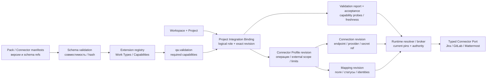

Новый Pack добавляется в исходники и composition registry; динамической загрузки произвольных runtime plugins нет. В manifest объявляются Work Types, capability requirements, events, UI slots и component refs. В актуальном QA наборе есть manifest revisions 1.0–1.4.

| Provider   | Capability / роль                                                                       | Назначение                                                                                                                 |
| ---------- | --------------------------------------------------------------------------------------- | -------------------------------------------------------------------------------------------------------------------------- |
| Jira       | `operational-work-item`; `QA_REQUEST_AUTHORITY`, `SOURCE_CONTEXT`, `DEFECT_DESTINATION` | Создание/import/read QA Request, подтверждённые operational changes, публикация defect                                     |
| GitLab     | `source-context.read`                                                                   | MR, commit, build context                                                                                                  |
| GitLab     | `test-executor.trigger-status`                                                          | `pipeline.trigger`, `pipeline.read`, `pipeline.lookup` по pinned ref/SHA/suite                                             |
| GitLab     | `artifact.ci-read`                                                                      | Metadata/stream утверждённых CI artifacts                                                                                  |
| Mattermost | `messaging.intake`, `messaging.notify`, `messaging.callback`                            | Intake, notification delivery, callbacks; QA capability requirements 1.4 отдельно объявляют pilot `messaging.notification` |

Connection/Profile/Mapping/Binding версионируются. Published revision не редактируется на месте; новая версия требует validation/публикации. Смена pins, прав или входных данных может аннулировать approval, readiness или предложение Hermes. Наличие binding и свежая работоспособность provider — разные факты.

Источники: [integration model](../../packages/platform-core/src/integration-registry/model.ts), [QA manifest 1.4](../../packages/competency-qa/src/manifest-v1.4.ts), [Jira manifest](../../packages/connector-jira/src/manifest.ts), [GitLab manifest](../../packages/connector-gitlab/src/manifest.ts), [Mattermost manifest](../../packages/connector-mattermost/src/manifest.ts), [ADR-0006](../adr/0006-project-integration-binding-versioning.md).

<a id="data"></a>

## 5. Владение данными и доменная модель

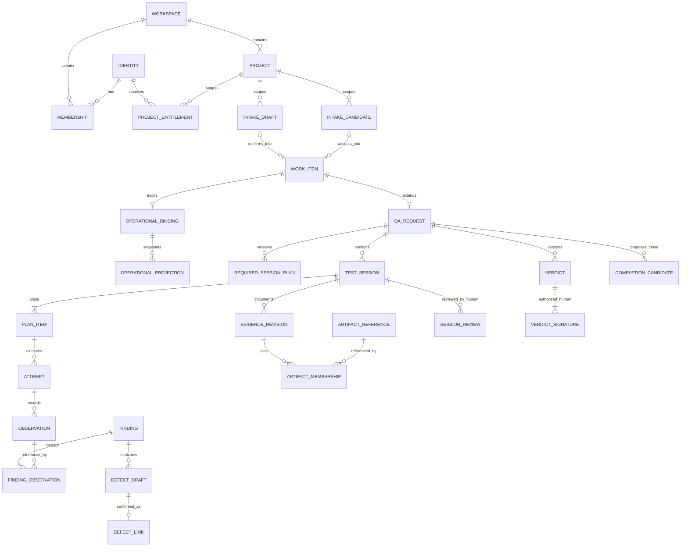

Это укрупнённая модель валидных бизнес-объектов. Промежуточные pending states, v1/v2 таблицы, точные revision memberships и все ограничения внешних ключей см. в migrations. Generic/Dummy Work Items не обязаны иметь Jira authority или QA extension.

| Хранилище / владелец              | Авторитетные данные                                                                                                                                                                           |
| --------------------------------- | --------------------------------------------------------------------------------------------------------------------------------------------------------------------------------------------- |
| **Jira**                          | Workflow/status, assignee, business priority, due date, Jira-native links/comments. Requested value в платформе не заменяет подтверждённое значение Jira                                      |
| **PostgreSQL / Core**             | Identity/access, registry/configuration, drafts/candidates/work items, approvals/actions, command/event delivery, queue/capacity/SLA, operational snapshots, audit и pilot/onboarding records |
| **PostgreSQL / QA**               | Session/plan/attempt lineage, Findings, signed evidence revisions, review/verdict/DoD, suite configuration pins, QA project resources                                                         |
| **PostgreSQL / Jira connector**   | Discovery/validation details, effect marker/sub-effects, ambiguous results и provider-specific reconciliation                                                                                 |
| **PostgreSQL / GitLab connector** | Discovery, webhook receipts, pipeline observations/projection heads, effect reconciliation/lookup, artifact locator/stream receipts                                                           |
| **GitLab artifacts**              | Физические байты CI-доказательств; платформа хранит ссылки, версии, hashes, provenance, retention и доступность без внутренней копии                                                          |
| **Vault / signer**                | Corporate secrets и remote signing key; в платформенных binding хранится ссылка, а не credential. История public keys имеет отдельный file-backed adapter                                     |
| **Mock Hub / `awp_mock`**         | Данные и effect logs эмуляторов; не часть production domain storage                                                                                                                           |

Актуальные schema pins полного состава: Core 235, Dummy 1000, Tech Writing 1100, QA 2110, Jira 3050, GitLab 4020. Реестр включает `pack:tech-writing` и в corporate persistence; это не означает подключённый corporate UI писателя. Порядок upgrade и проверки прав: [инструкция DevOps](../deployment/upgrade-and-verification.md).

AST-каталог содержит **242 EntitySchema declarations**: Core 123, QA 71, Jira 7, GitLab 12, Dummy 1, Mock Hub 28. Это **не число таблиц живой БД**: часть SQL-таблиц существует только в миграциях. Общая БД использует логических владельцев и table prefixes; `platform_schema_versions` хранит namespace/version. `synchronize=false`, миграции явные и транзакционные; API/worker используют один выбранный registry.

Версионирование построено на headers/heads + immutable revisions + `version/contentHash`. Queue read model можно пересобрать из подтверждённых фактов; event outbox служит доставке событий и не означает, что вся платформа реализована как event-sourced database.

Источники: [каталог таблиц](inventory.md#таблицы-entityschema), [Core entities](../../packages/platform-persistence-typeorm/src/entities/composition.ts), [QA entities](../../packages/competency-qa/src/persistence/entities.ts), [DataSource](../../packages/platform-persistence-typeorm/src/data-source.ts), [ADR-0002](../adr/0002-jira-operational-authority.md).

<a id="commands"></a>

## 6. Внешний effect: от HTTP до подтверждения

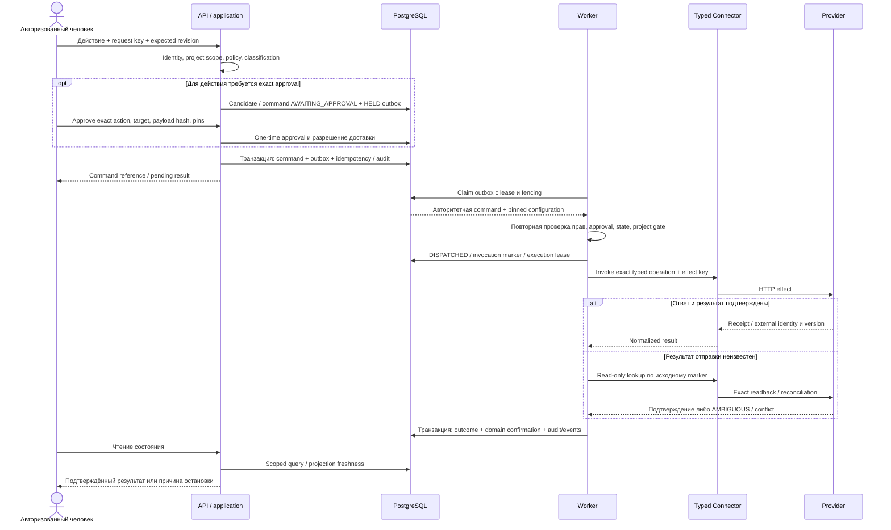

Внешний HTTP effect и PostgreSQL commit не являются одной транзакцией. Защита от повторной записи строится на client request key, стабильном effect marker, durable invocation marker, leases/fencing и connector-specific readback. После неопределённого POST система не делает слепой повтор. `AMBIGUOUS` — результат reconciliation, а не отдельное значение Core `CommandStatus`.

Три независимые оси состояния: `CommandStatus` (`AWAITING_APPROVAL`, `QUEUED`, `DISPATCHED`, `RETRY_SCHEDULED`, `CONFIRMED`, `CONFLICT`, `FAILED`, `CANCELLED`), effect authorization и outbox delivery. Нельзя свести их к одному флагу «готово».

Основной loop последовательно обходит фазы `recovery → dispatcher → commands` для подключённых contributions. Ошибка одного contribution фиксируется как deferred и не останавливает обход остальных. PostgreSQL visibility deadlines восстанавливают задания после потери process-local списка `#published`.

Redis/BullMQ не входят в v1. Jira/GitLab/Mattermost delivery выполняется через `TypeOrmCommandDeliveryStore`, PostgreSQL polling, leases и recovery; PostgreSQL является единственным durable delivery authority.

| Worker key полного local pilot  | Функция                                                                       |
| ------------------------------- | ----------------------------------------------------------------------------- |
| `qa-jira`                       | Request create/import/actions, defects и operational confirmation             |
| `mattermost`                    | Notification delivery, expiry, marker reconciliation                          |
| `queue.foundation`              | QA queue facts/projections, admission, capacity и temporal/SLA updates        |
| `artifact-retention`            | Availability/retention decisions; физическое удаление зависит от policy/holds |
| `project-onboarding-events`     | Scoped idempotent consumers для onboarding/operational events                 |
| `project-onboarding-probes`     | Published capability plans, requested probes и свежесть observations          |
| `project-suspension-recovery`   | Incident/suspension reconciliation с current effect fence                     |
| `gitlab.automation-trigger`     | Typed trigger и неопределённые результаты запуска                             |
| `gitlab.webhook-reconciliation` | Scheduling authoritative reads, bounded retries и recovery                    |
| `gitlab.automation-events`      | Durable event processing и перенос технических фактов в QA                    |

Источники: [command model](../../packages/platform-core/src/commanding/connector-command.ts), [delivery store](../../packages/platform-persistence-typeorm/src/command-delivery.store.ts), [Jira polling](../../packages/runtime-composition/src/jira/qa-worker-steps.ts#L128), [worker registry](../../packages/runtime-composition/src/pilot/composition.ts), [ADR-0007](../adr/0007-action-specific-exact-approval.md).

<a id="qa"></a>

## 7. QA-процесс и операционная очередь

```mermaid
flowchart LR
  source["Web / Mattermost<br/>Jira / GitLab discovery"] --> draft["Draft / Candidate<br/>SLA нет, capacity не занят"]
  draft --> confirm["Явное подтверждение<br/>create или import Jira QA Request"]
  confirm --> backlog["BACKLOG<br/>подтверждённый Work Item"]
  backlog --> dor["QA DoR<br/>scope / source / non-prod target<br/>resources / current revisions"]
  dor --> ready["READY<br/>Jira ready + QA ready/waiver<br/>SLA / capacity policy"]
  ready --> active["ACTIVE<br/>manual или automated session<br/>human WIP / review reservations"]
  active --> review["Human session review<br/>findings / evidence / residual risk"]
  review --> verdict["Human QA Verdict<br/>PASS / FAIL / BLOCKED / INCONCLUSIVE"]
  verdict --> dod["DoD + completion candidate<br/>exact approval / current facts"]
  dod --> done["Jira close confirmed<br/>COMPLETED"]
  hermes["Hermes proposals<br/>completeness · triage · plan<br/>review prep · defect draft"] -.-> draft
  hermes -.-> dor
  hermes -.-> review
```

Эта схема — нормальный сценарий работы, а не полный автомат переходов. Queue stage **вычисляется** из Jira operational projection + QA facts + controls. Отдельно хранятся freshness, consistency warnings и источники каждого факта. В частности, внешнее Jira `DONE` может показать `COMPLETED` с `TERMINAL_WITH_OPEN_QA`; одна стадия очереди не доказывает выполнение DoD.

Human WIP и review capacity отделены от технических pipeline executions. Admission и ordering имеют свои версии policy, права и транзакционные решения. Portfolio view строится только для доступных Project Scopes. SLA использует business calendar, сегменты часов, pause/control reasons и deduplicated threshold notifications; Candidate/Draft не запускает SLA.

| Понятие            | Значение                                                                                                                            |
| ------------------ | ----------------------------------------------------------------------------------------------------------------------------------- |
| Session lifecycle  | `PLANNED → READY → RUNNING → REVIEW_REQUIRED → COMPLETED`, с `BLOCKED`/`CANCELLED`; режим MANUAL или AUTOMATED фиксируется отдельно |
| Attempt result     | `PASS`, `ASSERTION_FAILED`, `INFRA_FAILED`, `TIMEOUT`, `CANCELLED`, `INCOMPLETE`                                                    |
| Session outcome    | `PASSED`, `FAILED`, `BLOCKED`, `INCONCLUSIVE`; не равен pipeline status                                                             |
| QA Verdict         | Подписанное решение QA-человека: `PASS`, `FAIL`, `BLOCKED`, `INCONCLUSIVE`                                                          |
| Service completion | Завершение согласованной QA-работы после DoD и Jira confirmation; **может иметь Verdict FAIL**                                      |

Failed observation сначала становится Finding. Человек классифицирует его как product/infra/inconclusive/duplicate/accepted risk, принимает либо отклоняет defect draft. Retry создаёт новый Attempt и сохраняет историю; failure → success не превращается автоматически в чистый PASS.

Источники: [queue stage](../../packages/platform-core/src/work-management/queue-stage.ts), [admission](../../packages/runtime-composition/src/queue/admission-service.ts), [SLA](../../packages/platform-core/src/work-management/sla-clock.ts), [QA sessions](../../packages/competency-qa/src/domain/test-session.ts), [ADR-0003](../adr/0003-qa-session-evidence-verdict.md).

<a id="automation"></a>

## 8. GitLab: автоматическое исполнение и обратная синхронизация

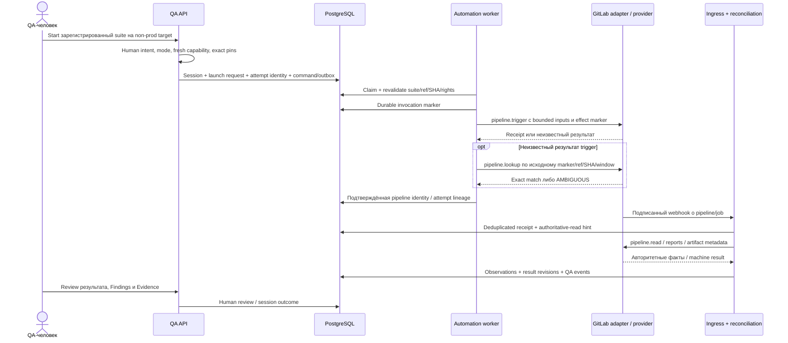

Webhook — повод для проверки, а не бесконтрольная запись QA outcome. Connector нормализует provider facts и artifact provenance. Backend сверяет connection/profile/binding, numeric project, actual SHA, marker, timestamps и receipt hashes. Replay не создаёт новый launch. Native `pipeline.retry`, `pipeline.cancel`, repository write, CI variable/secret read и production deployment не входят в разрешённую capability surface.

Источники: [automation worker](../../packages/runtime-composition/src/gitlab/automation-worker.ts), [reconciliation](../../packages/runtime-composition/src/gitlab/reconciliation-worker.ts), [connector manifest](../../packages/connector-gitlab/src/manifest.ts), [result sync](../../packages/runtime-composition/src/gitlab/result-sync.ts).

<a id="evidence"></a>

## 9. Evidence: байты, подпись, хранение и экспорт

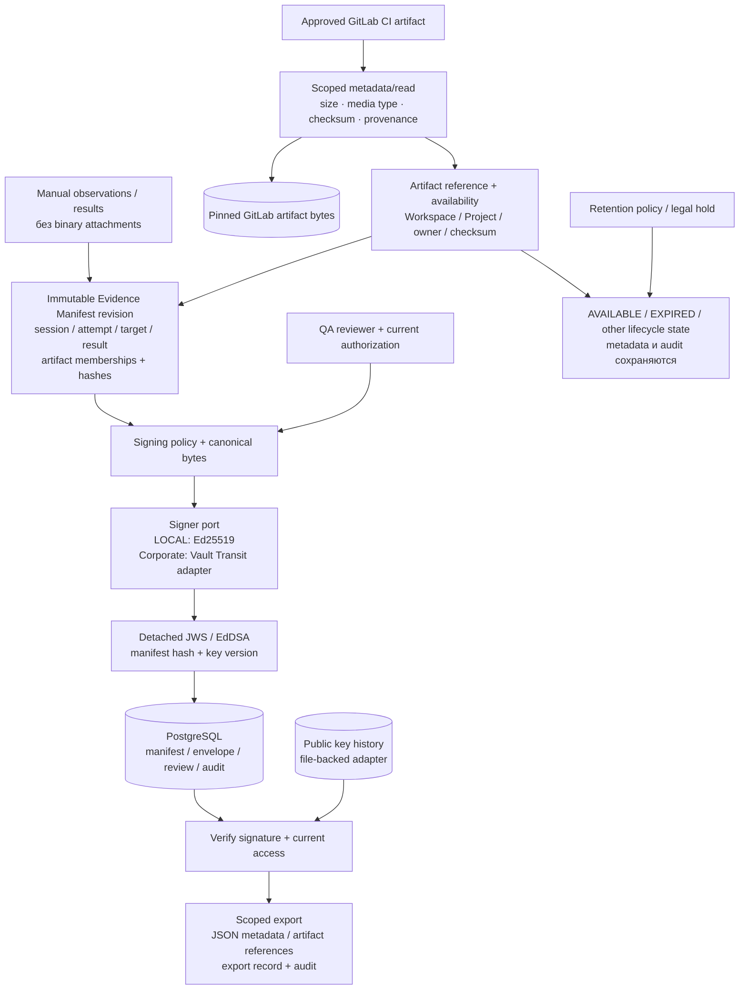

Revision подписанного evidence не обновляется на месте: correction создаёт новую revision с причиной и ссылкой на предыдущую. Доступность сырых байтов и криптографическая целостность manifest — разные свойства. Истечение retention не удаляет исторический факт, checksum или audit. Physical deletion не следует автоматически из перехода metadata state: применяется отдельная storage/retention authority.

В v1 платформа экспортирует JSON-метаданные evidence. Бинарные CI-артефакты остаются
в GitLab; загрузка произвольных вложений и ZIP-экспорт не подключены.

Корпоративный signer использует canonical JSON (`JCS_RFC8785`), detached JWS (`EdDSA`) и Vault signing endpoint с exact key version; ответ удалённого signer проверяется по public key. `FilePublicKeyHistory` требует устойчивого размещения/доставки ключей в реальной host-сборке. Private key не является содержимым evidence export.

Источники: [evidence service](../../packages/runtime-composition/src/onboarding/evidence-service.ts), [artifact source policy](../../packages/runtime-composition/src/pilot/artifact-source-policy.ts), [corporate signer](../../packages/runtime-composition/src/security/corporate-evidence-signing.ts), [public keys](../../packages/runtime-composition/src/security/public-key-history.ts), [evidence HTTP](../runbooks/evidence-http.md).

<a id="security"></a>

## 10. Security, onboarding и внешние входы

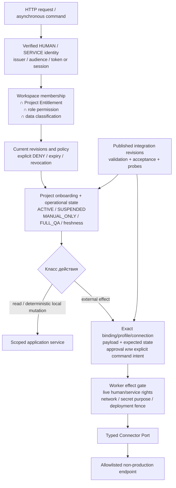

**Project scope проходит весь путь:** API context, repository query, revisions, command/outbox, execution, artifacts, audit. В БД добавлены составные `(workspace_id, project_id)` constraints; изоляция также реализуется через authorization и scoped repositories. В исследованном коде нет включения PostgreSQL RLS — схеме не приписывается эта защита.

**Администрирование:** глобальный `access-administrator` управляет людьми и ролями во всех Workspace. Первый успешный local HUMAN exchange и первый проверенный corporate OIDC login выбирают администраторов независимо; решения сохраняются транзакционно под advisory lock. Повторный seed, рестарт и отзыв не открывают выбор. Рабочие действия требуют membership, roles, project entitlements и classification; глобальная роль не обходит эти проверки. Локальный получатель дополнительно получает `project-registrar` в локальных областях. См. [ADR-0015](../adr/0015-first-corporate-administrator.md), [ADR-0016](../adr/0016-first-local-administrator.md).

**Onboarding:** регистрация проекта → versioned context/resources → integration bindings → validation + functional acceptance + fresh probes → capability assessment → авторизованное изменение состояния. Seed начинает новые local проекты с `DRAFT/MANUAL_ONLY`; успешный probe сам не активирует проект и не повышает mode. Suspension ставит effect fence; resume требует текущих incident/approval/probe фактов. Для scoped maintenance permissions (suspend/resume, evidence verify/export) Core допускает отдельные MUTATE-действия при соблюдении domain checks; это не разрешает внешние effects. Environment, test data и test account pool/lease принадлежат Project Scope.

**Approval:** фиксирует action identity, target, action-specific payload/content hash, expected state, exact config refs, approver basis, expiry и idempotency key. Для Jira transitions/assignment/priority/due-date и defect publication требуется exact approval. Явный запуск разрешённого stable smoke suite человеком может сам быть authorization intent без второго approval. Автономное решение модели не заменяет эти основания.

**Hermes:** subject — закрытое объединение `DRAFT | CANDIDATE | WORK_ITEM` с exact version/hash. Tool invocation требует одновременно human и service grants. Внешний контент считается недоверенным. Вердикт, доступы и прямые Jira effects не разрешаются tool gateway. Model outage не блокирует deterministic/manual flow. В corporate конфигурации не подтверждено подключение реального model provider и непрерывного исполнителя AgentRun.

| Вход                 | Локальный контур                                              | Corporate adapter / host requirement                                                                                                |
| -------------------- | ------------------------------------------------------------- | ----------------------------------------------------------------------------------------------------------------------------------- |
| Browser identity     | HTTPS Fake IdP, seeded persona exchange, signed local step-up | Pinned OIDC/JWKS, corporate session/PKCE, current grants, реальный step-up; требуется wiring                                        |
| Jira webhook         | Mock Hub signatures и durable receipt                         | Выбранный native/gateway dialect, HMAC/body timestamp, exact project и current pins                                                 |
| GitLab webhook       | Controlled signed fixture                                     | Standard Webhooks HMAC по ID/timestamp/raw bytes, validated conformance                                                             |
| Mattermost callbacks | Local interaction/identity fixtures                           | mTLS gateway + persisted opaque intent, exact human/team/channel/action; forwarded cert header сам по себе не удостоверяет источник |
| Secrets / network    | Local scoped resolver, internal-only network                  | Vault purpose-scoped leases, pinned network transport, endpoint/method/path allowlist и CA                                          |

Receipt и дальнейший read/intent hint сохраняются атомарно. Одинаковая delivery identity с другими байтами отклоняется. Повторная доставка сохраняет dedupe semantics после restart. Callback — транспорт UI, он не является самостоятельным approval или доверенной identity.

Источники: [authorization policy](../../packages/platform-core/src/identity-access/authorization-policy.ts), [scope migration](../../packages/platform-persistence-typeorm/src/migrations/core/0190-project-scope-constraints.ts), [onboarding](../../packages/runtime-composition/src/onboarding/composition.ts), [tool gateway](../../packages/runtime-composition/src/hermes/qa-tool-gateway.ts), [ADR-0008](../adr/0008-agent-run-subject-union.md), [ingress policy](../../config/pilot/ingress-policy.md).

<a id="deployment"></a>

## 11. Физическое развёртывание

### 11.1. Реализованный локальный Compose

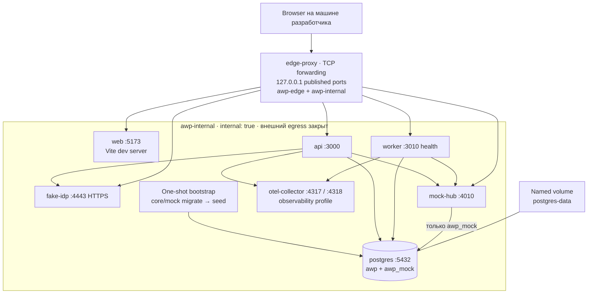

`edge-proxy` — локальный TCP forwarder, не корпоративный ingress/load balancer. PostgreSQL напрямую на host не опубликован. Bootstrap/migrator, runtime и Mock Hub используют разные DB roles; `awp_mock` не является второй authority для платформы. Node-приложения используют общий local runtime image; это не готовые release images.

| Endpoint         | Default local            | `dev:pilot`               |
| ---------------- | ------------------------ | ------------------------- |
| Web              | `http://localhost:5173`  | `http://localhost:55173`  |
| API              | `http://localhost:3000`  | `http://localhost:5300`   |
| Worker health    | `http://localhost:3010`  | `http://localhost:5310`   |
| Mock Hub         | `http://localhost:4010`  | `http://localhost:54010`  |
| Fake IdP         | `https://localhost:4443` | `https://localhost:54443` |
| OTLP gRPC / HTTP | `4317 / 4318`            | `54317 / 54318`           |

Источники: [Compose](../../infra/compose/docker-compose.local.yml), [DB roles](../../infra/compose/postgres/001-local-roles.sql), [pilot development](../runbooks/pilot-development.md).

### 11.2. Корпоративная схема подключения — требует завершения

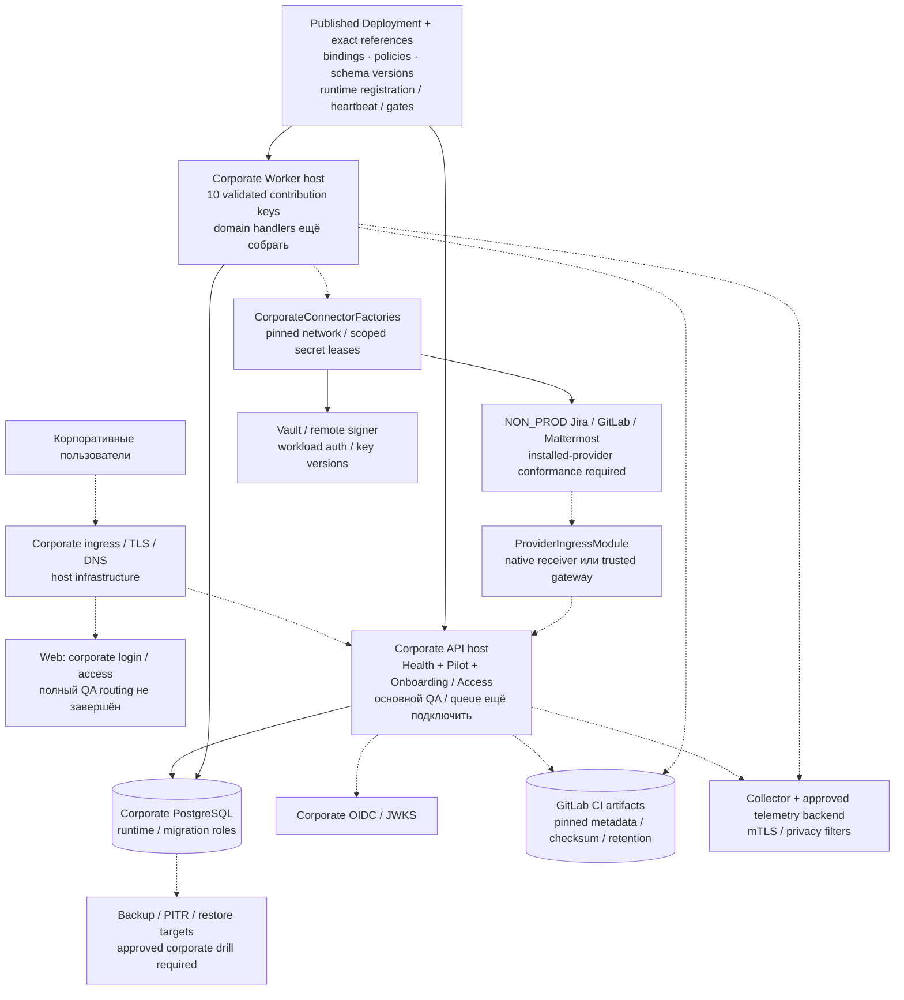

Пунктир в этой схеме означает **требуемое подключение host**, а не работающий корпоративный deployment. Проверены исходники adapters, но корпоративные адреса, topology, replica counts и фактические SLA/RPO/RTO по репозиторию не установлены.

На текущем срезе `PilotNonLocalApiModule.register()` подключает `HealthController` и `PilotController`, а при передаче `onboarding` дополнительно импортирует `CorporateOnboardingModule`. При наличии `onboarding.sessions` также подключается `CorporateAccessModule` с каталогом людей, назначениями и диалогами проектов. Corporate web с `VITE_AWP_AUTH_MODE=corporate` предоставляет `/`, `/access` и `/admin/users`; полный QA routing остаётся незавершённым. Onboarding module монтирует корпоративную authentication/session и шесть controllers: onboarding/published onboarding, project operations/published operations, project reads и evidence integrity. Он получает явные `CorporateSessionService`, `AccountInventoryPort` и `EvidenceCrypto`; это частичная прикладная corporate assembly. Основные QA-session, intake/queue и provider surfaces ещё не объединены здесь в полный runtime. CLI entrypoints вызывают bootstrap без mandatory `nonLocal` bindings, поэтому смена environment variables сама по себе не запускает полный corporate API. Worker `.register()` проверяет состав contributions; проверка ключей не доказывает выполнение бизнес-операций.

Источники: [non-local API registration](../../apps/api/src/app.module.ts#L624), [corporate onboarding module](../../apps/api/src/extensions/onboarding/corporate-onboarding.module.ts), [worker registration](../../apps/worker/src/app.module.ts#L408), [startup / composition](../../packages/runtime-composition/src/pilot/composition.ts), [deployment checklist](../runbooks/pilot-deployment-checklist.md).

<a id="operations"></a>

## 12. Эксплуатация, восстановление и незавершённые связи

| Область              | Реализованный механизм / граница                                                                                                                                                                                                                                  |
| -------------------- | ----------------------------------------------------------------------------------------------------------------------------------------------------------------------------------------------------------------------------------------------------------------- |
| Observability        | Safe structured logs, correlation/causation IDs, OTLP traces и метрики latency/outcomes; Collector оставляет allowlisted attributes. Local exporter — debug, corporate overlay — secured OTLP HTTP. Grafana/Prometheus/Tempo не поставляются как Compose services |
| Provider outage      | Capability health/freshness, отдельный admission каждого действия, bounded retry, honour Retry-After. Drafts/notes/manual paths остаются доступны там, где нет зависимости от упавшего provider                                                                   |
| Unknown write result | Persisted invocation marker + connector lookup; conflict/ambiguity не разрешаются автоматическим новым POST                                                                                                                                                       |
| Data recovery        | PostgreSQL durable commands/events/revisions, claims/fencing; GitLab artifact metadata/checksums; отдельные backup/PITR/restore/fence/reconcile tools                                                                                                             |
| Dead letters         | Versioned policy и scoped replay decisions, expiry/current authority; replay не отменяет uncertain-effect semantics                                                                                                                                               |
| Project suspension   | Current operational state/effect fence, события и recovery consumers; исторические metadata/audit сохраняются                                                                                                                                                     |
| Delivery / CI        | pnpm/Nx, architecture/contracts/unit/integration/e2e/security suites, migration gates 17/18, real local Docker + browser smoke                                                                                                                                    |
| Corporate release    | GitLab local job активен; corporate pipeline example, release images/deploy script и conformance требуют отдельной сборки/данных                                                                                                                                  |

[Предыдущий локальный Compose-аудит](../audits/2026-09-07-compose-smoke.md) относится к историческому контуру до ADR-0009. Текущая граница v1 проверяется Feature 010: PostgreSQL, Mock Hub, worker, API и web работают без Redis/S3.

### Открытые архитектурные подключения

1. **T025:** завершение полного corporate host для API/worker, business routes, реальных provider ports и release packaging. Optional onboarding/authentication/evidence module уже доступен; остальные прикладные связи остаются открытыми.
2. **T040/C1 и T057/N2:** реальные версии/диалекты/права Jira/GitLab/Mattermost и проверка выбранных adapters на конкретном NON_PROD стенде.
3. **T084:** corporate restore/PITR drill wrapper и доказательства фактических fence/reconcile/RPO/RTO. Сейчас prerequisite checker может вернуть `CORPORATE_DRILL_RESULT_REQUIRED`.
4. **T104–T106:** реальный shadow window, ограниченный pilot sample/guardrails и human review; local mocks не подтверждают эти этапы.
5. **Наблюдение по коду:** полный persistent Hermes executor не обнаружен в основной runtime wiring; это не объявляется новым формальным task ID.
6. **Не задано в репозитории:** фактическая корпоративная сетевая топология, HA/replication layout, autoscaling, размеры ресурсов, SLO и monitoring backend. На схемы не добавлены вымышленные кластеры Kubernetes или сервисы.

Источники: [telemetry config](../../infra/observability/otel-collector.yaml), [corporate overlay](../../infra/observability/otel-collector.corporate.yaml), [CI](../../.gitlab-ci.yml), [recovery](../runbooks/pilot-recovery.md), [текущие задачи](../../specs/008-pilot-hardening-and-conformance/tasks.md).

## 13. Полнота, исходники и проверка схемы

В комплект входят **11 Mermaid-диаграмм**, SVG-копии, HTML для просмотра и этот Markdown как редактируемый источник. [Технический каталог](inventory.md) и [inventory.json](inventory.json) содержат 24 packages, 242 EntitySchema declarations, 78 controllers, 329 объявленных HTTP routes и 31 NestJS modules с привязкой к исходникам. HTTP-каталог включает reusable и local-only declarations; он не утверждает, что все маршруты смонтированы одновременно.

Автоматический инвентарь прочитал 1058 исходных `.ts/.tsx/.mts` файлов приложений и пакетов, исключая файлы `*.spec.*`/`*.test.*`. Архитектурные выводы дополнительно сверены с bootstrap, composition и ADR; AST-счётчики сами по себе не доказывают корректность исполнения. Для обновления inventory: `node docs/architecture/generate-inventory.mjs` из корня. Для повторного SVG/HTML render используйте существующий renderer и локальные копии Mermaid 11.12.0 и Marked:

```sh
node docs/architecture/generate-inventory.mjs
node docs/architecture/render-diagrams.mjs --mermaid /absolute/path/mermaid.min.js --marked /absolute/path/marked.esm.js
```

Renderer требует установленный Chromium Playwright, пересоздаёт `.mmd`, SVG, HTML и PNG и проверяет все 11 диаграмм, внутренние ссылки, масштабирование и переполнение страницы. Результат сохраняется в `render-validation.json`.

Приоритет источников при расхождении: текущий bootstrap/registration и implementation → текущие tasks.md и последний scoped audit → ADR/feature design → общий README/старые reports. Фактические версии, время генерации и digest исходников записываются в `inventory.json`. Смена документации не является повторным выполнением runtime gate.
