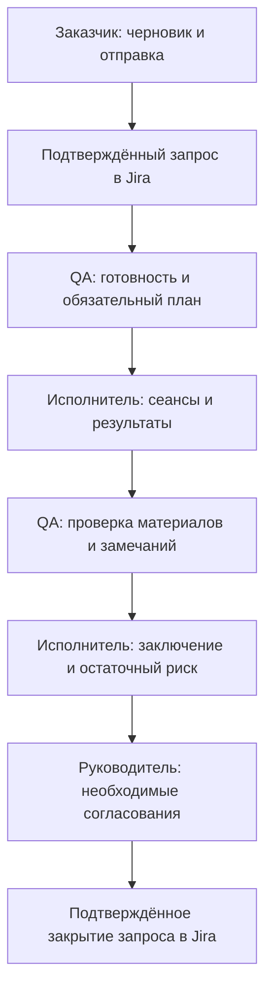

# Руководство пользователя Agentic Workspace Platform

Платформа помогает команде QA принять запрос, подготовить проверки, сохранить результаты
и оформить заключение. В этом руководстве описаны текущие возможности проекта,
порядок работы и обязанности участников. Сверено с интерфейсом и серверными правами
в рабочем дереве репозитория 10 сентября 2026 года.

## С чего начать

1. Если стенд ещё не запущен, выполните [локальный запуск](../../README.md#локальный-запуск).
   Для полного QA-сценария нужен `pnpm dev:pilot:up`.
2. Откройте [рабочее пространство QA](http://localhost:55173).
3. На новой установке сначала выполните [первый вход администратора](../deployment/upgrade-and-verification.md#обновить-локальный-pilot-без-потери-данных). Затем выберите **«Заказчик»** и нажмите **«Начать работу»**.
4. Откройте **«Новый запрос»**, заполните сведения, нажмите **«Проверить запрос»**,
   проверьте резюме и нажмите **«Отправить запрос»**.
5. Дождитесь сообщения **«Запрос создан»** и откройте запрос. Дальнейшие действия
   описаны в [инструкции заказчика](daily-work.md#заказчик).

У локальных участников уже есть рабочие назначения. В верхней панели видны участник
и рабочая область. Проект выбирают в форме создания или открывают по ссылке на карточку.
**«Сменить роль»** возвращает на экран входа и очищает рабочий контекст.
Переходы по меню сохраняют вход; обновление страницы требует повторного входа.
Смена роли в учебном стенде позволяет посмотреть работу разных участников. В реальной
среде права назначаются через проверенную систему идентификации.

## Выберите инструкцию для своей роли

| Роль                  | За что отвечает                                                                                     | Инструкция                                                          |
| --------------------- | --------------------------------------------------------------------------------------------------- | ------------------------------------------------------------------- |
| Заказчик              | Описывает задачу и ожидаемый результат, уточняет входные данные, получает заключение                | [Подать запрос и следить за ним](daily-work.md#заказчик)            |
| Исполнитель QA        | Проверяет готовность, планирует и выполняет проверки, фиксирует замечания и подписывает заключение  | [Провести проверку](daily-work.md#исполнитель-qa)                   |
| Руководитель QA       | Определяет порядок работы, проверяет риски, согласует исключения и закрытие запроса                 | [Управлять работой и согласованиями](daily-work.md#руководитель-qa) |
| Читатель              | Знакомится с разрешёнными запросами и состоянием очереди                                            | [Просматривать результаты](daily-work.md#читатель)                  |
| Администратор         | Управляет проектами, доступами и интеграциями; независимо согласует действия другого администратора | [Управлять проектами и доступами](administration.md#администратор)  |
| Оператор / DevOps     | Запускает и сопровождает стенд, контролирует сервисы, проводит восстановление                       | [Эксплуатировать стенд](administration.md#оператор-и-devops)        |
| Разработчик платформы | Меняет код и расширения, выполняет проверки, поддерживает локальный контур                          | [Работать с репозиторием](administration.md#разработчик-платформы)  |
| Спонсор пилота        | Согласует участников, критерии сравнения и решение по итогам пилота                                 | [Организовать пилот](administration.md#спонсор-пилота)              |

Оператор, разработчик и спонсор — организационные обязанности; отдельных одноимённых
персон в локальном переключателе нет. Служебные и проверочные персоны описаны
[отдельно](administration.md#служебная-идентичность).

## Как проходит запрос

Изменения рабочих статусов приходят из Jira: [как работает синхронизация и что делать при задержке](jira-status-sync.md).

Подготовку готовности и обязательного плана сейчас выполняют через API. Схема описывает
весь процесс; не каждый шаг имеет отдельную форму в браузере.

| Понятие                     | Что означает для пользователя                                                         |
| --------------------------- | ------------------------------------------------------------------------------------- |
| Workspace / рабочая область | Команды, проекты и правила доступа в одной границе безопасности                       |
| Project / проект            | Конкретный продукт или система со своими подключениями, средами и участниками         |
| Запрос / Work Item          | Подтверждённая работа QA; сохранённый черновик ещё не является принятым запросом      |
| Готовность / DoR            | Достаточно ли исходных данных, доступов и ресурсов, чтобы начать проверку             |
| Обязательный план           | Какие сеансы проверки необходимы для выполнения запроса                               |
| Сеанс / Session             | Отдельная ручная или автоматическая проверка с зафиксированной целью и областью       |
| Попытка / Attempt           | Одно выполнение проверки; повторный запуск сохраняет отдельную историю                |
| Замечание / Finding         | Обнаруженная проблема, которую QA должен классифицировать и рассмотреть               |
| Материалы / Evidence        | Наблюдения, результаты, ссылки на артефакты и подписанные сведения о проверке         |
| Заключение / Verdict        | Итог QA: пройдено, не пройдено, заблокировано или нет однозначного результата         |
| DoD                         | Проверка условий завершения: достаточно ли результатов и решений для закрытия запроса |
| Согласование / Approval     | Решение уполномоченного человека для конкретного действия и версии данных             |

Jira хранит рабочий статус запроса, исполнителя, приоритет и сроки. Платформа хранит
план QA, сеансы, материалы и решения людей. GitLab выполняет CI и хранит его артефакты.
Mattermost служит каналом обращений и уведомлений. Hermes готовит предложения,
которые проверяет человек.

**Заключение QA и закрытие запроса не являются разрешением на выпуск продукта.**
Запрос может быть закрыт с отрицательным заключением и открытым дефектом:
услуга QA выполнена, а продукт требует исправления.

## Где искать нужное

| Раздел интерфейса | Что здесь делать                                                                          |
| ----------------- | ----------------------------------------------------------------------------------------- |
| Обзор             | Увидеть текущий контекст и следующий шаг                                                  |
| Новый запрос      | Составить, проверить и отправить обращение                                                |
| Запросы           | Открыть подтверждённую заявку по названию                                                 |
| Очередь           | Посмотреть этапы, порядок, актуальность данных и доступную информацию о загрузке и сроках |
| Проекты           | Посмотреть доступные проекты и открыть состояние подключения                              |
| Как работать      | Прочитать краткую справку внутри приложения                                               |
| Дополнительно     | Открыть обращения из чата, предложения Hermes, автоматизацию и диагностику                |

Меню зависит от прав, проекта и включённых модулей. Отдельная кнопка в глубокой форме
ещё не означает наличие права на операцию: сервер проверяет его заново. Доступ
в Workspace сам по себе не даёт доступа ко всем проектам. Явный запрет, отзыв права
или ограничение классификации данных могут скрыть ресурс.

## Границы текущей версии

- Полный локальный pilot работает с эмуляторами Jira, GitLab и Mattermost.
  Корпоративный NON_PROD требует отдельной сборки и приёмки;
  [статус и оставшиеся работы](../deployment/README.md).
- Вкладка **«Готовность»** показывает оценку и план. Создание оценки, подтверждение
  готовности и публикация обязательного плана доступны через API.
- Ручной браузерный исполнитель содержит упрощённый успешный сценарий.
  Произвольные наблюдения и отрицательные результаты оформляются через API.
- В **«Проекты → Новый проект»** администратор или регистратор создаёт проект;
  карточку можно редактировать с соответствующим правом. Заказчик создаёт свой проект
  через [диалог с Hermes](customer-projects.md). Публичного создания Workspace пока нет.
- Глубокий экран подключения показывает состояние и прототипные действия.
  Для публикации и восстановления с актуальными версиями используйте
  [административную инструкцию](administration.md).
- В v1 нет загрузки произвольных файлов-вложений и ZIP-экспорта материалов.
  Ручные проверки используют текстовые наблюдения; бинарные CI-артефакты остаются
  в GitLab. Экспорт evidence содержит JSON-метаданные.
- Штатный seed не создаёт готовые результаты и подписанные заключения. Новый проект
  в `DRAFT / MANUAL_ONLY` ещё требует настройки и проверки готовности.

## Если действие не удалось

| Ситуация                                         | Что делать                                                                            | К кому обратиться                               |
| ------------------------------------------------ | ------------------------------------------------------------------------------------- | ----------------------------------------------- |
| Не загружается список ролей или приложение       | Проверить `pnpm dev:pilot:status`, доступность API и логи                             | Оператор / разработчик                          |
| Нет нужного раздела или получен отказ в доступе  | Проверить роль и проект; запросить необходимое проектное право                        | Администратор                                   |
| Ресурс возвращает 404                            | Проверить ссылку и текущий доступ: 404 может означать скрытый ресурс                  | Администратор                                   |
| Версия изменилась / HTTP 409                     | Обновить сведения, перечитать актуальное состояние и повторно рассмотреть действие    | Исполнитель операции                            |
| Неизвестен результат отправки запроса            | Нажать «Проверить состояние»; дождаться проверки прежней отправки                     | Оператор при затяжной обработке                 |
| Не опубликован план или готовность заблокирована | Посмотреть причину; уточнить данные, ресурсы и опубликовать план через API            | Исполнитель QA / руководитель QA                |
| Требуется дополнительное подтверждение входа     | Использовать кнопку подтверждения в верхней панели; локально оно действует пять минут | Владелец / администратор                        |
| Автоматизация недоступна                         | Проверить режим проекта, Suite, среду и подключения                                   | Администратор                                   |
| Операция ожидает согласования                    | Передать конкретное действие уполномоченному другому участнику                        | Руководитель QA или владелец — по виду действия |
| Статус внешней операции неизвестен               | Сохранить ID операции, проверить логи и результат у провайдера до повторного запуска  | Оператор / администратор                        |

Для обращения за помощью сохраните проект, ID запроса или операции, время и текст ошибки.
Не прикладывайте токены входа и секреты подключения.

Технические команды: [справочник разработчика](../runbooks/developer-commands.md).
Дальнейшая работа: [инструкции команды QA](daily-work.md) и
[инструкции администрирования](administration.md).

## Общая команда и выбор проекта

Два участника `executor.alpha` и `executor.qa2` представлены как «Исполнитель QA · QA 1» и «Исполнитель QA · QA 2».
У обоих одна роль `qa-executor` во всех проектах рабочей области. Старые ключи входа с `.alpha`/`.beta` сохранены для совместимости и больше не задают проектный доступ.
Очередь и список запросов объединяют все доступные проекты. Проект указан на задаче; переход по ссылке открывает её в правильном контексте. Указывать проект нужно при создании запроса или открытии его настроек.
Новый проект автоматически получает права действующей общей команды. Заказчики
получают доступ по конкретным проектным назначениям; чужие заказчики его не наследуют. Явные запреты, классификация и граница рабочей области продолжают действовать.
Хлебные крошки ведут на главную, страницу выбранного проекта и текущий раздел.

- [Создать свой проект с Hermes и получить доступ](customer-projects.md).
- [Техническая документация: писатель и лид](tech-writing.md) — локальная рабочая область, ревью и утверждение.
